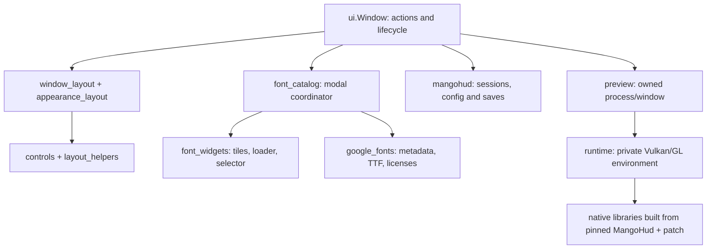

# Architecture and code map

Vela is a Linux desktop controller for MangoHud with an opt-in private native
renderer. It is not a browser app and does not run CSS/HTML for the game HUD.
There are three distinct outputs: Qt controls, the owned embedded preview, and
MangoHud injected into games. A Qt visual change does not automatically change
the in-game renderer.

## Start here

## Modules by responsibility

| File | Responsibility / change here when… |
| --- | --- |
| `vela/ui.py` | Main Window state and user actions: selection, explicit save, limiter, font/color changes, shutdown. `main()` is the stable launcher entry point. |
| `vela/window_layout.py` | Assemble left customization, center preview and right limiter/experimental column. Install named controls on Window and connect its handlers. |
| `vela/appearance_layout.py` | Build metric, typography, background, padding, border and shadow controls; dictionaries use native option names. |
| `vela/layout_helpers.py` | Section headings and dividers shared by builders. |
| `vela/controls.py` | Wheel-safe inputs, process labels, path editor, FPS stepper, dependency rows and scroll fades. |
| `vela/theme.py` | Main palette, Qt stylesheet, font-browser stylesheet and cached root grid/gradient. |
| `vela/panels.py` | Shared `FrostedPanel`, rounded clipping/border and matching loader underlay. |
| `vela/background.py` | Cached procedural frosted RGB texture. This is a Qt material, not game backdrop blur. |
| `vela/animation.py` | Paint-only button feedback, page spacing and tile hover/reveal effects. |
| `vela/font_catalog.py` | Modal orchestration, categories, paging, bounded widget cache, staged loading, animations and delayed-callback cancellation. |
| `vela/font_widgets.py` | Weight selector, spinner/Loading fonts cover and one FontCard. Owner/service are injected; no import of Window. |
| `vela/google_fonts.py` | Immutable family metadata, CSS2 TTF resolution, full download/license manifest, local caches and bounded preview requests. |
| `vela/mangohud.py` | Discover eligible processes, select watched config, parse managed values and safely persist profiles/limits. |
| `vela/settings.py` | Process-name validation, Wine executable-name helpers and ASCII matching. |
| `vela/preview.py` | Start/stop only the owned scene subprocess; identify/embed its native window; private config and notification coordination. |
| `vela/scene.py`, `preview_runner.py` | Render and launch the real OpenGL preview scene. |
| `vela/notifications.py` | Animated status/choice presentation above the native preview; save-destination choices. |
| `vela/layer_order.py` | Optional LSFG Vulkan Loader ordering configuration and owned-file cleanup. |
| `vela/runtime.py` | Game launcher environment for private Vulkan manifest and GL shim; leaves system MangoHud installed. |
| `scripts/install.py` | User-local install/uninstall and launchers; copy libraries atomically. |
| `scripts/build_mangohud.py` | Verify pinned upstream revision, apply native patch, compile and copy libraries. |

## Data flow and ownership

1. Window builds controls, loads the global preview configuration and polls
   MangoHud sessions. UI dictionaries match `appearance_values`/`metric_values`.
2. Editing a control calls `apply_customization`: only the preview's private
   watched file is changed. The native preview renders the real backend.
3. Save chooses global configuration or game profile, checks the selected
   process identity again, then uses `mangohud.save_appearance`.
4. Apply/Disable limit is the separate live limiter workflow.
5. Font downloads write Vela's font/cache directories, not MangoHud profiles.
   Use font returns `(key, path)` to Window and updates preview appearance.

Builders have no independent application state. They expose named controls
on Window intentionally, avoiding a second source of configuration truth. The
controller remains the authority for persistence and process selection.

## Native renderer boundary

Private x86_64 binaries are in `vela/native/x86_64`. They implement noise,
borders, shadows, padding and real GPU blur. `native/mangohud-background.patch`
is the reproducible source delta against pinned MangoHud v0.8.2. Never assume
a `/tmp` source tree is present; reconstruct it from the build script.

Vulkan keeps capture images per in-flight overlay draw. SDR blur copies only
the HUD region plus sampling margin to a reduced texture; text stays sharp.
HDR color conversion is surface-dependent and uses a private copy of the
latest settings. It must not mutate the shared configuration snapshot. See
`native/README.md`, `native/TESTING.md` and `native/color_state_test.cpp`.
