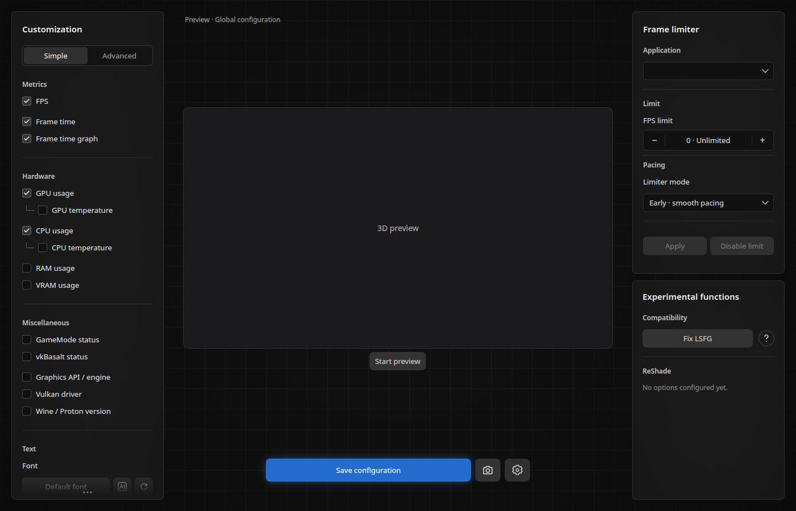
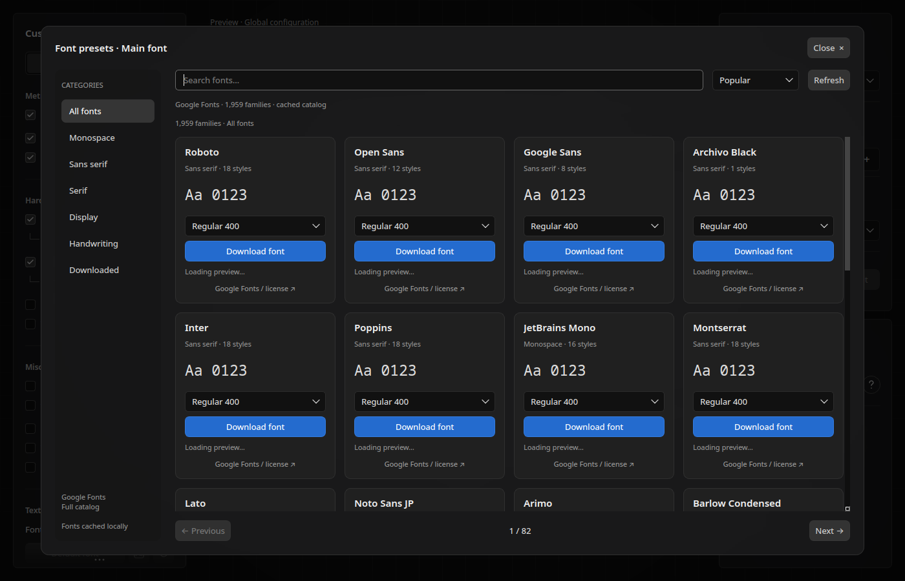

# Visual design and interaction contract

These are existing design decisions, not proposed features. Screenshots below
are offscreen renders of the actual widgets, not mockups.

## Main window

The app has three columns: a 268 px customization panel on the left, flexible
embedded 3D preview in the middle, and a 268 px limiter/experimental column on
the right. Outer margins are 20 px and splitter handles 18 px. The window has
a 1060×600 minimum and restores its saved dimensions.

Typography is Noto Sans, 13 px; panel titles are 15 px semibold and section
labels 12 px semibold. Text is off-white (#dddddd), secondary labels gray.
Main action blue is #246bce. Inputs use #111111 with #2c2c2c borders; buttons
#333333 with rounded 7 px corners. The root is a restrained #090909–#121212
radial gradient with a fading 36 px grid. `theme.py` contains exact values.

Frosted surfaces use the same cached 268×576 procedural texture, strength .35,
base 24. It is stretched into rounded panels with a #303030 border. Preserve
this subtle material: it is intentionally almost black, not bright glass or
an obvious grid. `FrostedPanel` is shared by settings and the font modal.

Simple/Advanced controls use spacing transitions. Buttons have paint-only
hover/press feedback, while save availability has a soft blue pulse. These
effects do not move the HUD or resize input hit regions.

## Font browser

The browser is an inset modal, not a replacement full-window page. A frozen
image of Vela remains visible through a dim overlay. The real native preview
is temporarily hidden to prevent native child stacking above Qt.

The left category rail is 164 px. The right side has search, Popular/Name
sorting, refresh status, responsive tiles and previous/next page navigation.
The full Google Fonts catalog is browsable, 24 families per page. At most a
few visited pages' widgets are kept; only visible tiles fetch specimens.

A tile exposes family/category, a real typeface specimen after loading, numeric
weight/italic selection, Download/Use and a source/license link. Mouse wheel
never changes the selected weight. The open list itself scrolls and shows at
most seven rows. Both font fields open the local-file chooser on left-click, while their
catalog icons browse downloadable fonts. There is no right-click font menu.

## Timing and responsiveness

- Modal opens in 400 ms and closes in 260 ms; dimming follows the same progress.
- Category marker moves in 340 ms; the outgoing grid fades/slides in 320 ms.
- Tiles enter in reading order, every 65 ms, over 420 ms each. A small upward
  starting offset settles downward into place while opacity rises to 1.
- Loading fonts has a 1100 ms looping spinner. Widgets are built three at a
  time with 12 ms yields; Qt font registration drains one item every 20 ms.
- The loader holds for 650 ms after preparation, with bounded extra waits for
  pending previews. It never waits indefinitely for the network.
- Closing, reopening, paging and filtering invalidate queued reveal/loading
  callbacks by generation. Test these interruptions after animation changes.

Qt frosted material and in-game GPU blur are separate renderers. The UI can
have frosted panels while the game uses a different supported HUD background.

## Preview backgrounds

The camera button opens Preview options. Background offers Frosted scene
(the original animated cube) Daylight · aerial view, and Night · aerial view (generated day/night
versions of the same game-like landscape, image only). Selection is saved in QSettings, sent to
the owned GL scene through background.txt, and switches live without restarting
the scene. No MangoHud game/profile option is added or changed. Both textures
are uploaded once; only the selected texture is drawn per frame.

## Collapsible customization groups

Metrics, Hardware, Miscellaneous, Text, Background, Border and Shadow have
clickable disclosure headers. Groups start expanded. Each header saves its
state immediately in QSettings as `sections/customization/<title>/expanded`.
Collapsing hides controls without changing their values or the preview/HUD.
The next launch restores each section independently. `sections.py` owns the
widget; `layout_helpers.section` opts into it when preferences are supplied.

Pause animation is dimmed/disabled for still-image backgrounds, including
when restoring a saved image choice at launch. The previous pause selection
is retained and becomes editable again for the frosted/cube scene.

Choosing the same file for main and additional text fonts normalizes the
additional override to empty and displays Same as main font. File identity
comparison also handles symlink and hard-link aliases. Distinct weights/files
remain independent. Changing the main font to the existing additional file
also restores inheritance.

## Settings and Advanced

The gear opens an inset frosted Settings modal with the same margins, sidebar,
dimming and 400/260 ms entrance/exit as the font browser. Configuration holds
the global file path, Browse, Open directory and a read-only contents view.
The existing path-change/load/save handlers remain owned by Window.

Simple contains standard MangoHud metrics, text and base background controls.
Advanced contains only Vela MangoHud extensions: padding, blur, noise, border
and shadow. Collapsible sections and their independent persisted state remain
available on both tabs. The configuration inspector no longer occupies Advanced.

## Preview profile and unsaved edits

The caption is `Preview - Global configuration` or `Preview - <profile name>`.
Profile names come from the actual loaded file, without `.conf` or the Wine
`wine-` prefix. Selecting a process loads its applicable profile into both the
editor and preview. Processes without their own profile use global settings.

If the appearance buffer differs from its last loaded/saved snapshot, process
selection is rolled back and the existing notification card presents Save and
switch / Discard and switch / Cancel. Save writes the original loaded file,
not the destination process's profile. Cancel or dismissal keeps the editor
unchanged. Failed saves and missing destination processes keep the choice
and edit buffer alive. Limiter Apply remains a separate live action.

## ReShade

Set up ReShade opens the shared frosted modal, hides the owned native preview,
and dims the main window. The entry screen has two equal, fully clickable tiles:
Configure and Install. Each tile vertically aligns its icon, title and description.

### Navigation and geometry

All panels are centered with at least 24 px outer margins. Content scrolls when
necessary; dimensions below are maximums, not minimum window requirements.

| Page | Maximum size |
| --- | --- |
| Configure/Install chooser | 720 × 380 px |
| Configure game selection | 720 × 460 px |
| Editable Configure | 820 × 560 px |
| Installation steps | 900 × 680 px |
| Completed removal | 720 × 320 px |

Install uses a 148 px rail: Game → Effects → Review → Install → Ready.
Step content fades in over 280 ms. Configure game selection hides Rendering API;
installation retains it. Detecting existing ReShade/hook files during Install
redirects to Configure. A hook from another mod is not proof of ReShade ownership.

Closing resets both branches, all choices and scroll positions to the entry
screen. Active work finishes in the background; both entry actions remain disabled
until completion. Background completion cannot switch the reset screen to Ready.
Closing the main application is deferred while installer/library work is active.
Back from removal review returns to Configure. The completed-removal page has
only Done; Close and Set up another game are hidden there.

### Configure

A full-width blue card shows the gamepad icon, Steam game name (EXE-stem fallback),
location and installation state. Its folder, pen and trash icons open the game
directory, open ReShade.ini, and begin the separately confirmed removal flow.
Trash is available only for Vela-managed installations.

Below it, 21 editable cards use two columns and a search field. Matching cards
repack without changing values or dirty state. Native number-input arrows are
hidden; shared −/+ controls remain. Numeric inputs and the alpha slider ignore
wheel events. Save changes pulses only when values differ from the loaded buffer.
Loading, searching and editing do not write files. Saving preserves unrelated
INI settings and presets. External file edits block a stale save. Restart the game
to apply changes; changing runtime builds requires a separate installation.

### Validation and removal

Missing/invalid fields remain clickable and use one shared validation style.
The primary action is softly dimmed until required choices are present. A failed
attempt plays a gentle 1100 ms pulse (75% peak), then retains a subtle 45% red
border/background with no animated halo. Text stays bright. Another failed
attempt restarts the pulse; editing clears it. The removal scope and game-closed
confirmation share the same padded card style and a larger checkbox.

FieldGlow queues/coalesces show/hide/enabled synchronization. Never restore a
stylesheet synchronously from Hide propagation: this caused a reproduced xcb
hang. Checkbox hover painting uses Qt's actual indicator rectangle, including
padding, rather than a fixed rectangle that leaves a white artifact.

Review uses read-only icon/value cards. Installation/removal still requires
explicit game-closed confirmation. Ordinary removal preserves modified files;
complete removal lists its broader scope before confirmation. Operational errors
retain diagnostic messages rather than masquerading as an invalid EXE.

## HDR diagnostics

HDR diagnostics uses the same centered 900 × 680 px modal bounds, with shared
read-only metric cards and hover motion. Each connected display has its own group;
system information has a separate group. Refresh runs a bounded asynchronous
KScreen query. Missing data is Unknown, not Disabled, and Qt fallback geometry
is explicitly labeled. Copy report exports the full plain-text snapshot.

The report describes desktop state, not a game's PQ/scRGB swapchain, calibration
or active HDR rendering. Diagnostic reads do not change display settings.
