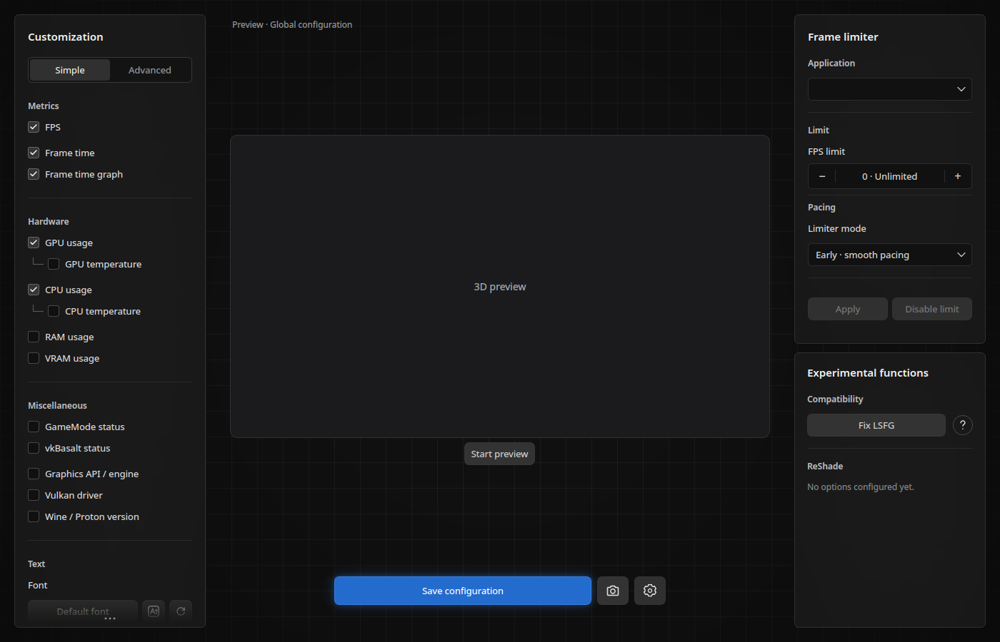
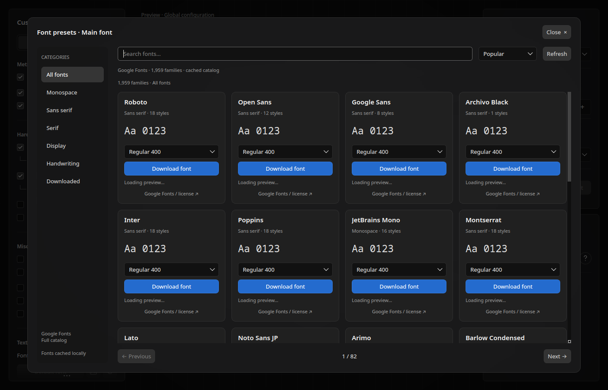

# Visual design and interaction contract

These are existing design decisions, not proposed features. Screenshots below
are offscreen renders of the actual widgets, not mockups.

## Main window

The app has three columns: a 268 px customization panel on the left, flexible
embedded 3D preview in the middle, and a 268 px limiter/experimental column on
the right. Outer margins are 20 px and splitter handles 18 px. The window has
a 1060×600 minimum and restores its saved dimensions.

Typography is Noto Sans, 13 px; panel titles are 15 px semibold and section
labels 12 px semibold. Text is off-white (#dddddd), secondary labels gray.
Main action blue is #246bce. Inputs use #111111 with #2c2c2c borders; buttons
#333333 with rounded 7 px corners. The root is a restrained #090909–#121212
radial gradient with a fading 36 px grid. `theme.py` contains exact values.

Frosted surfaces use the same cached 268×576 procedural texture, strength .35,
base 24. It is stretched into rounded panels with a #303030 border. Preserve
this subtle material: it is intentionally almost black, not bright glass or
an obvious grid. `FrostedPanel` is shared by settings and the font modal.

Simple/Advanced controls use spacing transitions. Buttons have paint-only
hover/press feedback, while save availability has a soft blue pulse. These
effects do not move the HUD or resize input hit regions.

## Font browser

The browser is an inset modal, not a replacement full-window page. A frozen
image of Vela remains visible through a dim overlay. The real native preview
is temporarily hidden to prevent native child stacking above Qt.

The left category rail is 164 px. The right side has search, Popular/Name
sorting, refresh status, responsive tiles and previous/next page navigation.
The full Google Fonts catalog is browsable, 24 families per page. At most a
few visited pages' widgets are kept; only visible tiles fetch specimens.

A tile exposes family/category, a real typeface specimen after loading, numeric
weight/italic selection, Download/Use and a source/license link. Mouse wheel
never changes the selected weight. The open list itself scrolls and shows at
most seven rows. Additional text font click copies the current main font;
right-click opens a local-file option, while its catalog icon selects another.

## Timing and responsiveness

- Modal opens in 400 ms and closes in 260 ms; dimming follows the same progress.
- Category marker moves in 340 ms; the outgoing grid fades/slides in 320 ms.
- Tiles enter in reading order, every 65 ms, over 420 ms each. A small upward
  starting offset settles downward into place while opacity rises to 1.
- Loading fonts has a 1100 ms looping spinner. Widgets are built three at a
  time with 12 ms yields; Qt font registration drains one item every 20 ms.
- The loader holds for 650 ms after preparation, with bounded extra waits for
  pending previews. It never waits indefinitely for the network.
- Closing, reopening, paging and filtering invalidate queued reveal/loading
  callbacks by generation. Test these interruptions after animation changes.

Qt frosted material and in-game GPU blur are separate renderers. The UI can
have frosted panels while the game uses a different supported HUD background.
